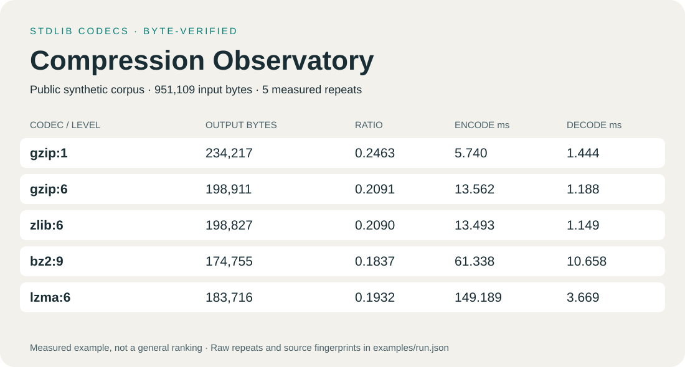

# Compression Observatory

[](https://github.com/Absamad-dew/compression-observatory/actions/workflows/ci.yml)

Measure lossless compression with Python's `gzip`, `zlib`, `bz2` and `lzma`. Get byte-exact verification, raw timing repetitions, weighted aggregate ratios, Pareto flags and an offline HTML report from one command. Runtime dependencies: Python 3.11+ and its standard library.

This is an original, general-purpose benchmarking toolkit. It contains **no new compression algorithm, private codec implementation, proprietary corpus or unpublished research mechanism**. The included synthetic example is a demonstration of measurement, not evidence for any private R&D claim.



## Run an experiment

```sh
python -m pip install .
compression-observatory generate corpus --seed 1729 --records 2000
compression-observatory bench corpus --codecs gzip:1,gzip:6,zlib:6,bz2:9,lzma:6 --warmups 1 --repeats 5 --json results/run.json --html results/report.html
```

Open `results/report.html` in a browser. It is a single file with inline SVG and CSS, no scripts, network requests, external fonts or tracking. The [measured example](examples/report.html) and [raw JSON](examples/run.json) are committed; [run provenance](examples/PROVENANCE.md) records what was actually executed.

`python -m compression_observatory` is equivalent to the installed command. Re-render saved measurements without running codecs:

```sh
compression-observatory report results/run.json --html results/report.html
```

## Use your own data

```sh
compression-observatory bench ./my-public-fixtures --max-files 200 --max-file-bytes 8388608 --max-total-bytes 33554432 --json results/custom.json --html results/custom.html
```

The directory must be explicitly supplied. Reads are recursive and sorted. Symlinks, Windows reparse points, special files and paths traversing links are rejected. Default limits are 1,000 files, 16 MiB per file and 64 MiB total (including the manifest). Files are loaded into memory before measurement. This is a local tool for a stable directory snapshot, not a security sandbox for concurrently hostile filesystem writers. Outputs must be outside the input directory.

Reports contain relative file names, hashes, sizes and environment metadata; they do not contain file contents, absolute input paths or host/user names. Review names and hashes before sharing a report. The root `corpus-manifest.json` is reserved metadata, excluded from codec inputs and validated against the exact file list and hashes. A matching manifest is an origin assertion, not proof that data came from this generator; reports label it `manifest-verified` and preserve the declared origin separately. Ordinary directories are labelled `user-directory`.

## What is measured

* Codec specifications are an explicit allowlist: `gzip:0..9`, `zlib:0..9`, `bz2:1..9`, `lzma:0..9`. No dynamic plugin loading or arbitrary execution.
* Every file gets an independent compressed stream, including headers. Gzip uses `mtime=0`; LZMA uses XZ format. Repeated compressed bytes must match within a run.
* Each file/codec pair has the configured warmups, then measured repetitions. Only encode/decode calls are timed using `perf_counter_ns`; reading, hashing and verification stay outside timers. Every iteration, including warmups, must reproduce the exact bytes and SHA256. Any failure aborts the experiment before successful output is written.
* Ratio means `sum(output bytes) / sum(input bytes)`, never an unweighted mean of file ratios. Empty-file ratios are JSON `null`; empty streams still contribute their headers to aggregate size. An all-empty corpus has a null aggregate ratio.
* Aggregate timing is the median of **per-repeat sums across files**. Each timing distribution includes raw samples, median, nearest-rank p95 and population coefficient of variation (CV). These are diagnostics, not confidence intervals.
* Size/encode and size/decode Pareto flags use aggregate bytes and median call times. A point is dominated only if another point is no worse on both axes and strictly better on at least one; exact ties remain on the frontier.

All execution is serial in fixed codec-major/file-major order; memory use, disk performance, process startup, peak RSS, parallel throughput and streaming behavior are **not measured**. Compression levels are library-specific, not comparable quantities. Short calls, fixed-order bias, cache effects, CPU frequency, background workloads and interpreter/library versions can change rankings. Rerun on representative public data and inspect variation before making a decision. Source fingerprints, Python/OS/architecture and zlib runtime version are recorded; Python does not expose every linked bz2/lzma library version here. Reports contain no claim of hardware-wide isolation.

## Public synthetic corpus

`generate` creates seeded JSONL events, service logs, word-based prose, UTF-8 text, repeated text, pseudo-random bytes and an empty file. It refuses to overwrite a nonempty directory. The manifest records seed, generator version, byte lengths and SHA256 hashes. The pseudo-random bytes are not cryptographic and the corpus is intentionally small and artificial. Corpus bytes/hashes are reproducible for the same generator/Python behavior; timings and some codec headers may vary across Python/library versions.

## Develop and verify

```sh
python -m pip install .
python -m unittest discover -s tests -v
```

Tests cover byte round trips (including empty and Unicode files), corrupted/failed/nondeterministic adapters, timer boundaries, weighted aggregation, Pareto ties, manifest tampering, input limits, links/reparse points, report escaping and the installed CLI workflow. Symlink tests skip when Windows does not grant link creation. CI is configured for Linux/Windows on Python 3.11 and 3.13; a local passing run is not a claim that hosted CI has already passed.

See [the concise Russian overview](README.ru.md), [contributing notes](CONTRIBUTING.md) and the [MIT license](LICENSE).
